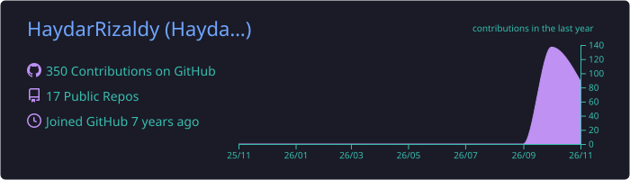
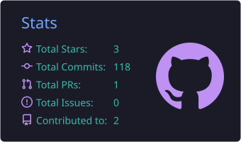
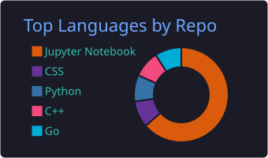

# Hi, I'm Haydar Rizaldy 👋

Data engineer focused on analytics, data engineering, and applied automation.

## 🙋 About Me

- 💼 Data Engineer Intern @ ALVA Digital Network
- 🎓 Informatics, Telkom University
- 📫 Reach me: haydarrizaldyputera@gmail.com

## 🛠️ Tech Stack

  
  
  
  
  
  
  
  
  

  
  
  
  
  
  
  
  
  

## 🚀 Featured Projects

| Project | What it is | Stack |
|---|---|---|
| 🌐 [portfolio](https://github.com/HaydarRizaldy/portfolio) | Personal portfolio site — [live](https://haydarrizaldy.vercel.app) | Next.js · Tailwind · Vercel |
| 💳 [Credit-Risk-Prediction-and-Analysis](https://github.com/HaydarRizaldy/Credit-Risk-Prediction-and-Analysis) | Credit risk prediction and analysis | Python · Jupyter |
| 🩺 [Predict-Diabetes-Classification](https://github.com/HaydarRizaldy/Predict-Diabetes-Classification) | Diabetes classification model | Python · Jupyter |
| ✊ [ImageClassification-RockPaperScissor](https://github.com/HaydarRizaldy/ImageClassification-RockPaperScissor) | Rock-paper-scissors image classifier | Python · TensorFlow |
| 📶 [Sort-Visualization](https://github.com/HaydarRizaldy/Sort-Visualization) | Quick & bubble sort visualizer with a Tkinter GUI | Python · Tkinter |
| 📈 [Credit-Card-Customers-Statistics](https://github.com/HaydarRizaldy/Credit-Card-Customers-Statistics) | Statistical analysis of credit card customers | Python · Jupyter |

## 📊 GitHub Stats

## 🐍 Contribution Snake

<picture>
  <source media="(prefers-color-scheme: dark)" srcset="https://raw.githubusercontent.com/HaydarRizaldy/HaydarRizaldy/output/github-snake-dark.svg" />
  <source media="(prefers-color-scheme: light)" srcset="https://raw.githubusercontent.com/HaydarRizaldy/HaydarRizaldy/output/github-snake.svg" />
  
</picture>

---

✨ **[Visit my portfolio →](https://haydarrizaldy.vercel.app)** ✨

